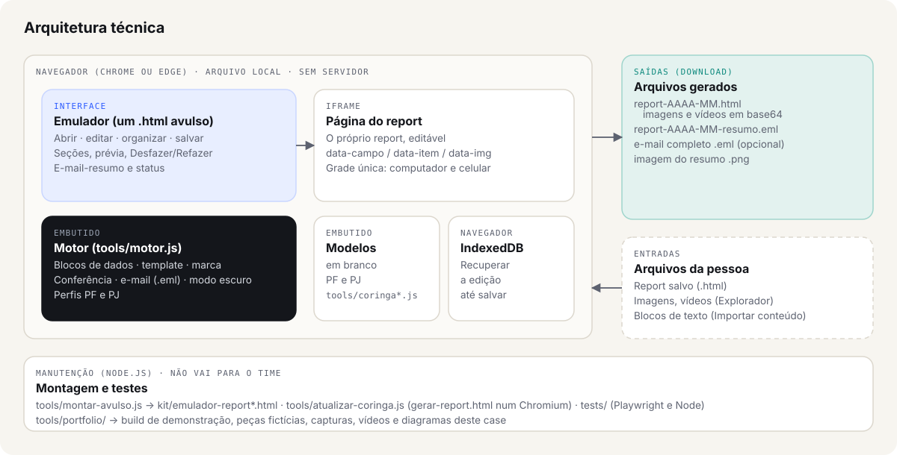
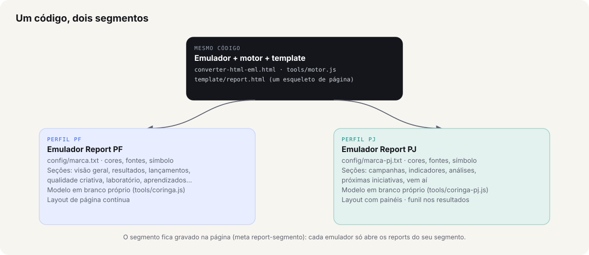
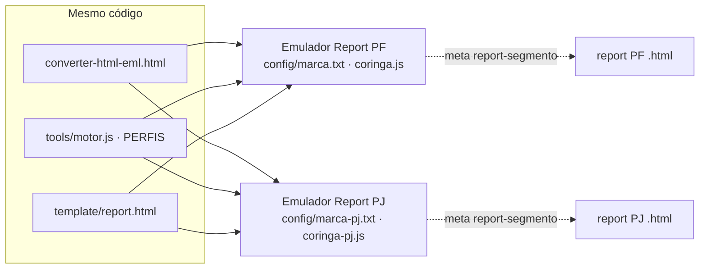
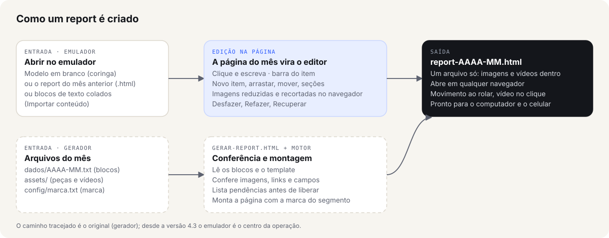
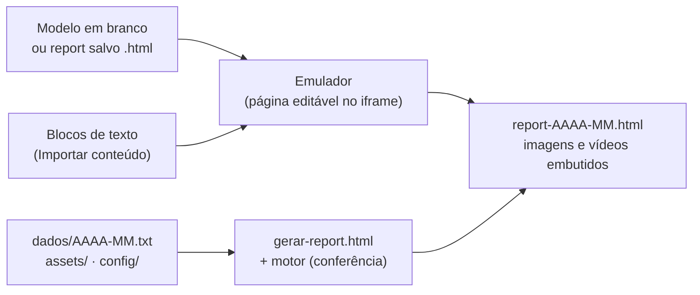
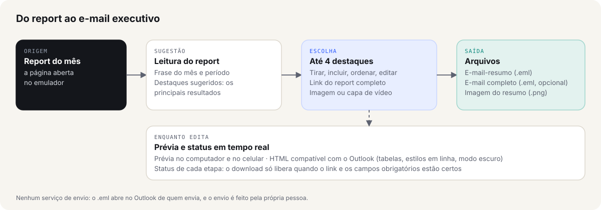
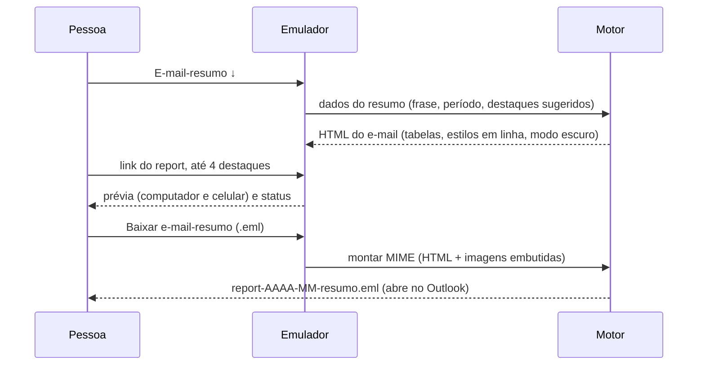
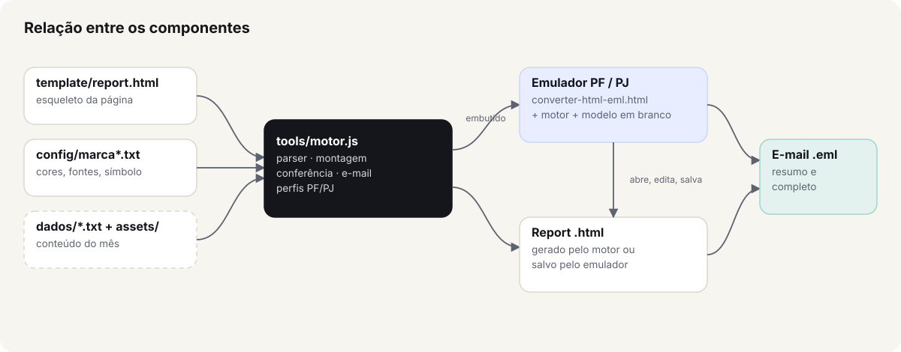

# Arquitetura

Tudo roda **no navegador, a partir de um arquivo local**. Não há servidor, banco de dados, API, serviço de e-mail nem chamada de rede: o emulador lê arquivos que a pessoa escolhe e entrega arquivos para download. O Node.js entra só na manutenção, para montar os emuladores avulsos e rodar os testes.

## Componentes

| Componente | Arquivo | Papel |
|---|---|---|
| Emulador (interface) | `converter-html-eml.html` | Abrir, editar (com a página do report num `iframe`), organizar, salvar, gerar o e-mail-resumo. Inclui um Web Worker para o trabalho pesado (separar e juntar mídia em base64) |
| Motor | `tools/motor.js` | Lê os blocos de dados (`[EDICAO]`, `[NUMERO 1]`…), aplica o template e a marca, confere pendências, monta o HTML do e-mail e o `.eml` (MIME), gera o CSS de modo escuro e define os perfis PF e PJ |
| Template | `template/report.html` | O esqueleto da página do report, o mesmo para PF e PJ (as cores e os nomes vêm do perfil e da marca) |
| Marca | `config/marca.txt`, `config/marca-pj.txt` | Fontes, cores, símbolo, regras de imagens e de links de cada segmento |
| Modelos em branco | `tools/coringa.js`, `tools/coringa-pj.js` | O report em branco de cada segmento, gerado de `dados/CORINGA*.txt` |
| Gerador por dados | `gerar-report.html` | O caminho original: lê `dados/*.txt`, `assets/` e `config/`, confere e gera a página do mês |
| Montagem | `tools/montar-avulso.js` | Embute o motor e o modelo no emulador, gerando um único `.html` por segmento |
| Atualização do modelo | `tools/atualizar-coringa.js` | Gera o modelo em branco pelo `gerar-report.html` num Chromium de verdade (Playwright) |
| Testes | `tests/` | Ponta a ponta (Playwright) e do motor (Node) |
| Portfólio | `tools/portfolio/` | Build de demonstração, peças e dados fictícios, capturas, vídeos, diagramas e banner deste case |

## Um código, dois segmentos

## Como um report é criado

## Do report ao e-mail

## Relação entre os componentes

## Decisões de arquitetura

| Decisão | Motivo | Consequência |
|---|---|---|
| Arquivo local, sem servidor | Ambiente corporativo sem instalação; dados internos não saem do computador | Tudo em JavaScript no navegador; nada para hospedar |
| Report como `.html` autocontido | Abrir em qualquer lugar e arquivar o mês inteiro num arquivo | Imagens reduzidas no navegador para manter o arquivo leve; trabalho pesado num Web Worker |
| A página é o editor | Quem edita vê exatamente o que vai sair | Campos marcados no template (`data-campo`, `data-item`, `data-img`) |
| Motor único com perfis | PF e PJ com as mesmas funções e identidades próprias | Mudanças valem para os dois; testes rodam no PF e no PJ |
| E-mail em HTML "à moda Outlook" | O Outlook para Windows ignora boa parte do CSS moderno | Tabelas, estilos em linha, cantos retos, modo escuro tratado e testado |
| Sem cálculo de indicadores | Os números são responsabilidade de quem os reporta | A ferramenta apresenta; não inventa nem completa dados |

## Build de demonstração

O build de demonstração ([`tools/portfolio/montar-demo.js`](../tools/portfolio/montar-demo.js) → [`demo/`](demo/)) usa **o mesmo código** e troca apenas, numa cópia de trabalho:
- a marca (cores, fontes abertas e o símbolo do case);
- os nomes de área e os rótulos de seção;
- os dados (fictícios).

No fim, uma conferência automática bloqueia o build se algum termo, ícone ou fonte da marca original aparecer na tela.
