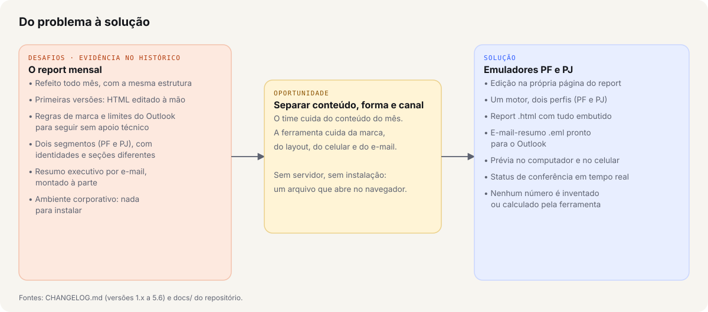

# Problema e solução

## Como as dores foram levantadas

As dores abaixo vêm do **histórico do próprio repositório**: o que foi construído, corrigido e documentado em cada versão. Nenhuma foi medida em intensidade (não há pesquisa ou métrica registrada). Por isso o texto descreve o que aparece documentado, sem afirmar quanto cada dor custava.

## As dores

### 1. O report é refeito todo mês

**Evidência.** O fluxo mensal documentado ([`COMO_ATUALIZAR_O_MES.md`](COMO_ATUALIZAR_O_MES.md)) repete os mesmos passos todo mês: organizar as imagens, editar, salvar, conferir, pôr o link e enviar.

**Decisão.** Abrir o **report do mês anterior** e editar só o que mudou. Para começar do zero, há um **modelo em branco** com todas as seções.

### 2. Editar exigia conhecimento técnico

**Evidência.** As versões 1.x e 2.x eram "e-mail HTML editável à mão" ([CHANGELOG](../CHANGELOG.md)). A 3.x trocou isso por arquivos de dados em texto e um motor de geração. A 4.3 colocou o **emulador** no centro: a edição acontece na própria página.

**Decisão.** Clicar e escrever, com uma barra de ações sobre o item. Desfazer, Refazer e Recuperar a edição dão segurança para experimentar.

### 3. Manter a consistência visual

**Evidência.** A marca foi centralizada em `config/marca.txt` e `config/marca-pj.txt` (cores, fontes, símbolo, regras de imagem e link), com um guia de tipografia e decisões registradas por versão.

**Decisão.** O motor aplica a forma; o time mexe só no conteúdo. Uma única grade atende o computador e o celular, e um teste mede essa grade a cada mudança.

### 4. O e-mail precisa chegar como foi visto

**Evidência.** [`OUTLOOK_COMPATIBILITY.md`](OUTLOOK_COMPATIBILITY.md), [`HOW_TO_EXPORT_EML.md`](HOW_TO_EXPORT_EML.md) e as correções de modo escuro da 4.12.1 (quadrados no Outlook clássico).

**Decisão.** E-mail em tabelas e estilos em linha, com modo escuro tratado e testado. O arquivo `.eml` é gerado no navegador e abre direto no Outlook.

### 5. Dois segmentos, duas identidades

**Evidência.** As versões 5.0 a 5.4 criaram o Emulador PJ, unificaram o esqueleto de página e aplicaram a identidade do segmento.

**Decisão.** Um código e dois perfis. Muda a marca, os nomes das seções, o modelo em branco e o layout. O segmento fica gravado na página, e um emulador não altera o report do outro.

### 6. O resumo executivo era um trabalho à parte

**Evidência.** O e-mail-resumo existe desde a 3.9. Desde a 4.13, a pessoa escolhe até 4 destaques.

**Decisão.** O resumo nasce da própria página, com sugestão automática, escolha manual, prévia e status em tempo real.

### 7. Quem usa não é técnico e não pode instalar nada

**Evidência.** [`CORPORATE_SETUP.md`](CORPORATE_SETUP.md) e o kit entregue ao time: um arquivo, dois cliques.

**Decisão.** Um emulador avulso, sem servidor e sem dependências, que roda no Chrome ou no Edge.

### 8. Números precisam ser confiáveis

**Evidência.** As regras do emulador estão no [README operacional](operacao.md).

**Decisão.** A ferramenta não cria nem calcula número. Indicador sem dado fica oculto: nunca aparece 0 nem o número do mês anterior.

## A oportunidade

**Separar conteúdo, forma e canal.** O time cuida do que mudou no mês. A ferramenta cuida da marca, do layout, do celular e do e-mail. Tudo cabe num arquivo que abre no navegador.

## A solução, em uma frase

Dois emuladores (PF e PJ) que transformam o report mensal numa página editável e geram, a partir dela, o report completo (`.html`) e o e-mail executivo (`.eml`).

## O que foi deliberadamente deixado de fora

- **Integração com fontes de dados ou envio automático de e-mail.** Não havia requisito nem autorização para isso, e manter tudo local evita expor dados internos.
- **Cálculo automático de indicadores.** Os números vêm de quem é responsável por eles, e a ferramenta só os apresenta.
- **Banco de dados ou servidor.** O emulador tinha de funcionar num computador corporativo, sem instalação.
