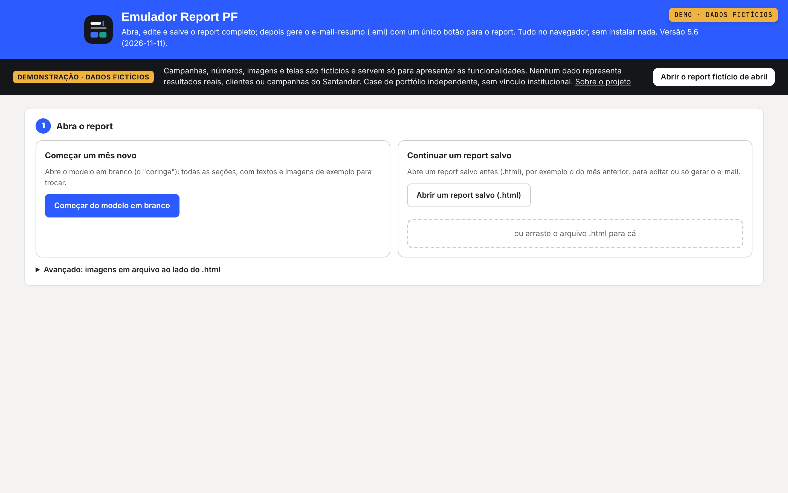
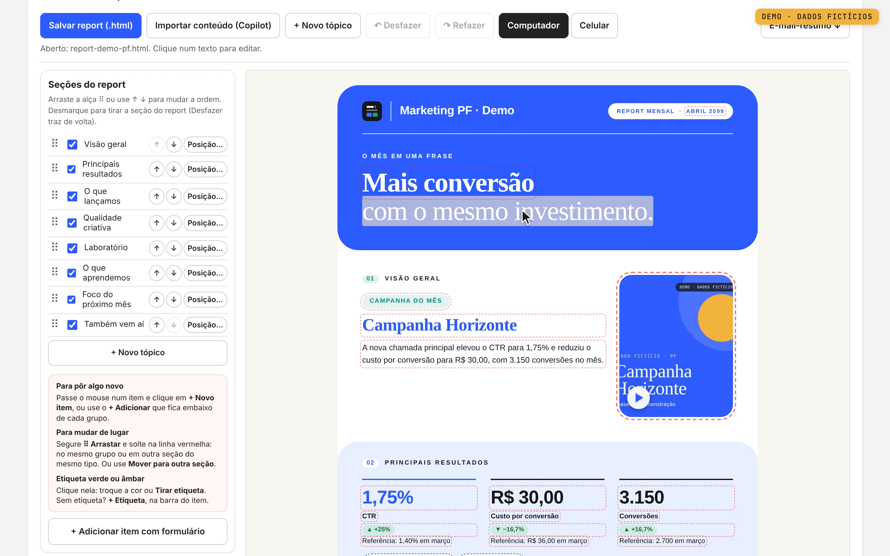
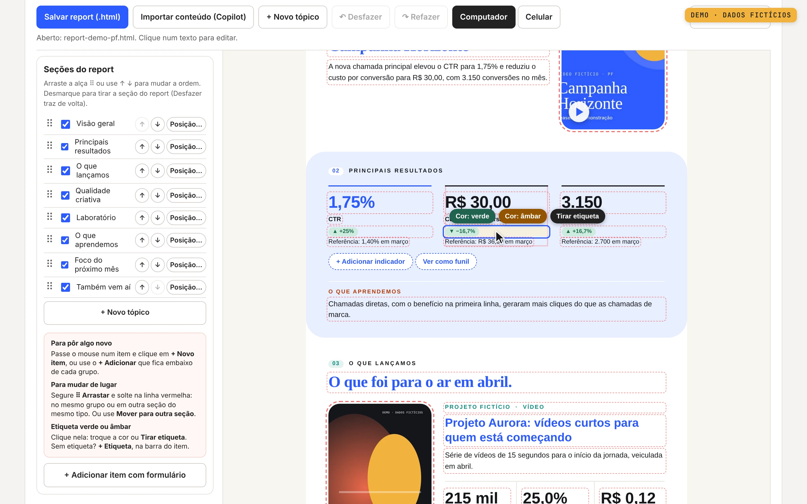
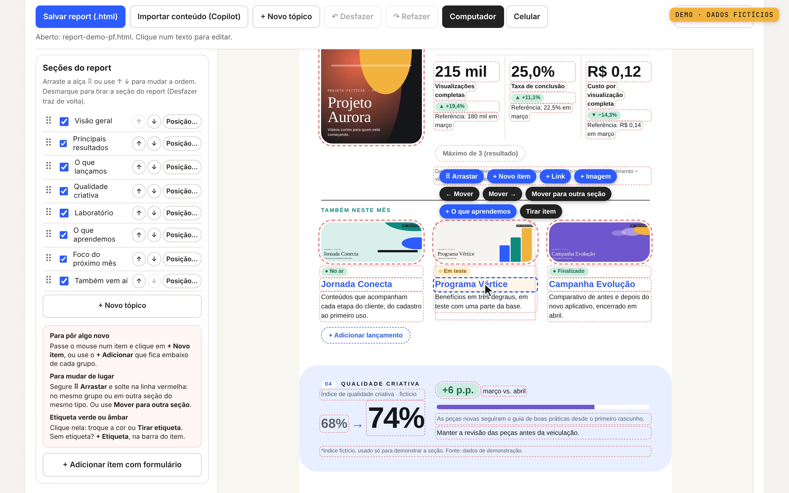
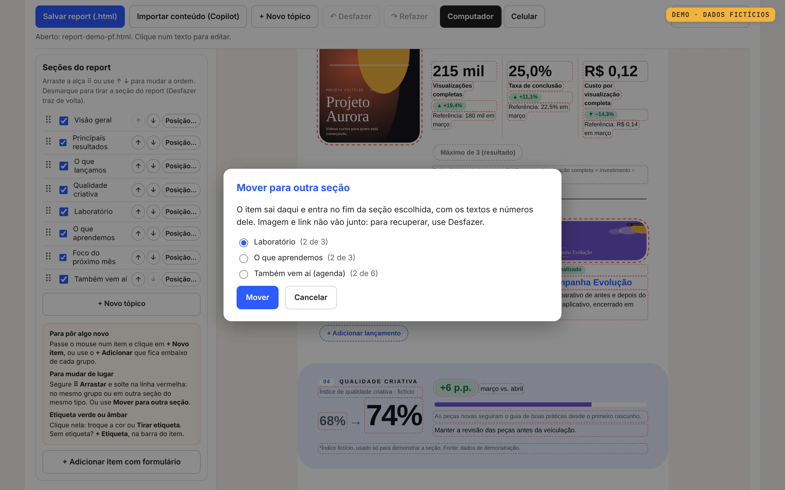
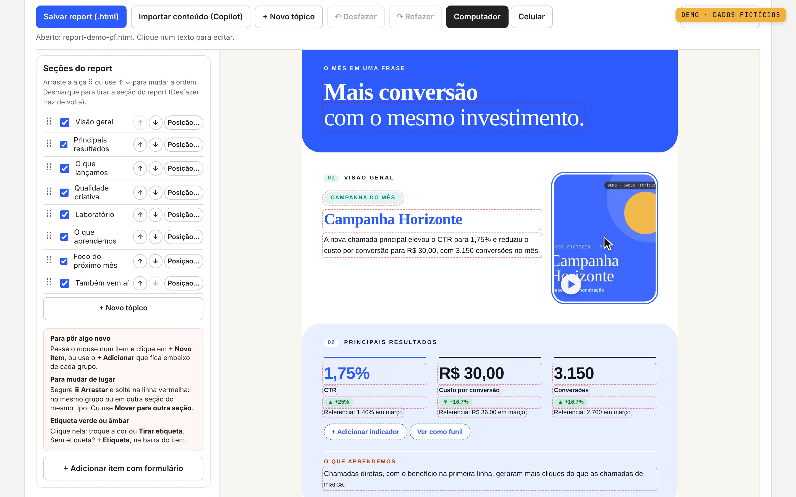
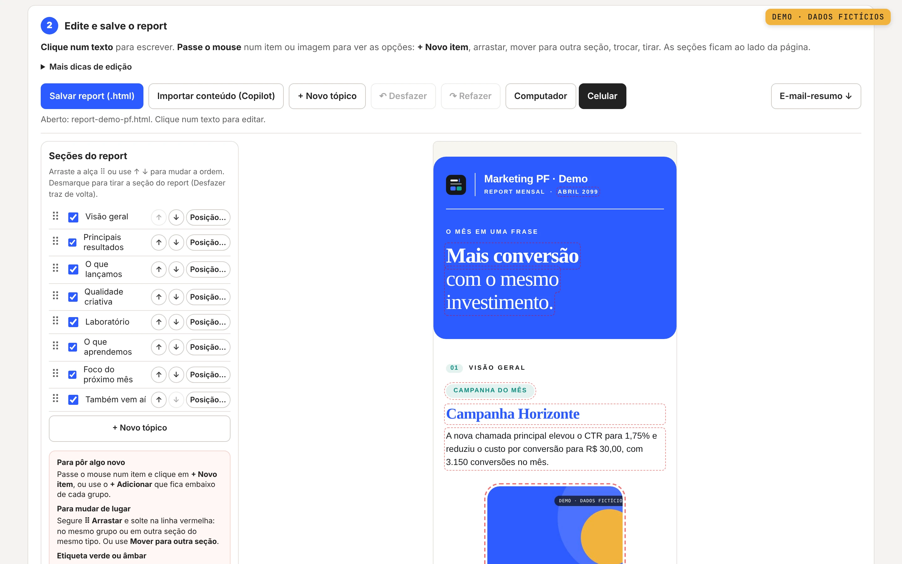
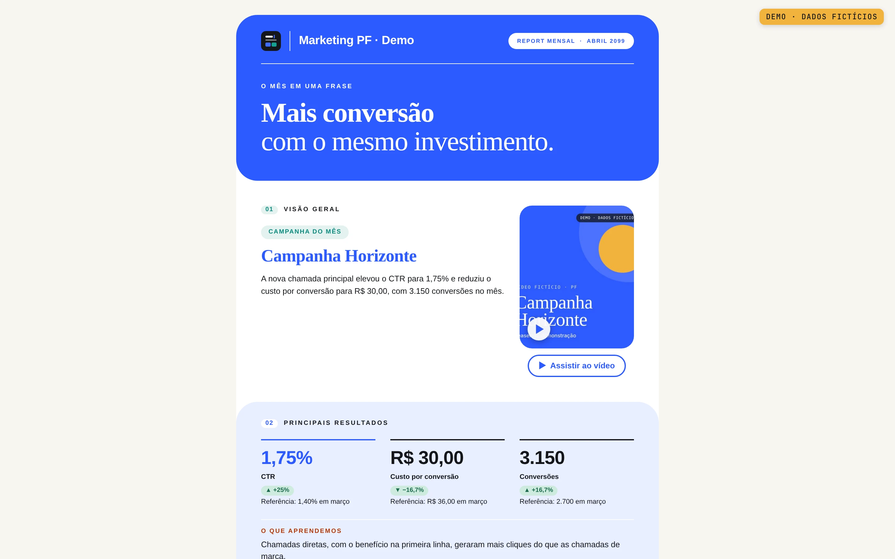
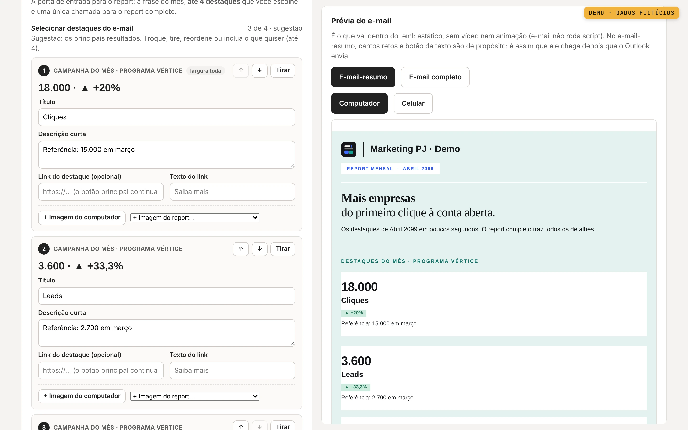
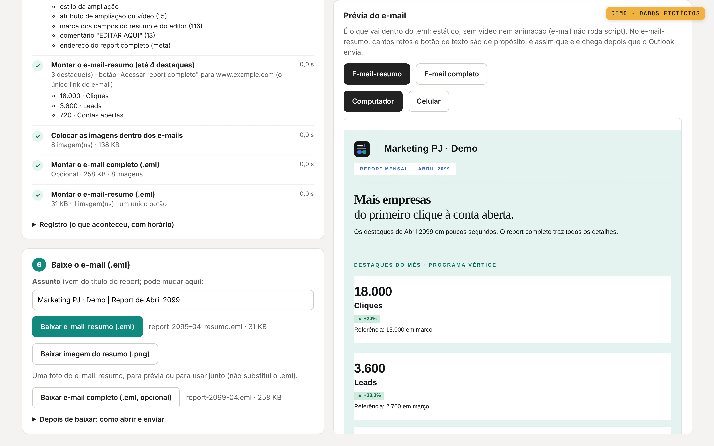

# Guia de uso

Como usar os emuladores, do arquivo aberto ao e-mail enviado. As telas são do build de demonstração (identidade do case, dados fictícios); o build de produção funciona da mesma forma.

> [!NOTE]
> **Demonstração fictícia:** as telas deste guia usam campanhas, números e imagens inventados para apresentar as funcionalidades. Nenhum dado representa resultados reais.

## 0. Antes de começar

- Use o **Chrome** ou o **Edge**.
- Deixe numa pasta: o report do mês anterior (`report-AAAA-MM.html`), as imagens e os vídeos do mês.
- Para experimentar sem nada disso, use a demonstração: [`demo/emulador-pf.html`](demo/emulador-pf.html) e [`demo/report-demo-pf.html`](demo/report-demo-pf.html).

## 1. Abrir

Dois cliques no emulador (`emulador-report.html` para PF, `emulador-report-pj.html` para PJ). Na tela inicial, há dois caminhos:
- **Começar do modelo em branco** abre um report com todas as seções, com textos `[entre colchetes]` para trocar;
- **Abrir um report salvo** abre o report do mês anterior (o mais comum). Também dá para arrastar o arquivo para a página.

Se o navegador fechou antes de salvar, o emulador oferece **Recuperar a edição**.

## 2. Editar

- **Textos:** passe o mouse (aparece um contorno), clique e escreva. Enter termina.
- **Período:** trocar o mês atualiza o período em todos os lugares.
- **Indicadores:** valor, nome, variação e referência.
- **Etiqueta** (a pílula verde ou âmbar):
  - clique nela para trocar a cor;
  - **Tirar etiqueta** quando ela não vale no mês;
  - **+ Etiqueta**, na barra do item, para pôr de volta.
- **Desfazer** e **Refazer** ficam na barra de cima.

## 3. Organizar

Passe o mouse num item para ver a barra dele:
- **+ Novo item:** um item igual entra logo depois, com textos para trocar.
- **⠿ Arrastar:** segure e solte na linha de encaixe, no mesmo grupo ou num grupo compatível.
- **Mover para outra seção:** leva o item, com textos e números, para uma seção do mesmo tipo.

As **seções** ficam ao lado da página:
- desmarque para tirar uma seção e marque de novo para trazer de volta;
- mude a ordem pelas setas ou pela alça;
- **+ Novo tópico** cria uma seção nova, com nome e layout.

## 4. Imagens, vídeos e links

Passe o mouse na imagem para ver a barra dela:
- **Trocar imagem** abre o Explorador de Arquivos. O emulador recorta e reduz a imagem sozinho.
- **Colocar vídeo** fica na imagem de um card.
- **Imagem embaixo** leva a peça da visão geral para baixo do texto.
- **+ Link** fica na barra do item: escreva o texto do link e cole o endereço.

## 5. Conferir

- **Celular** mostra a página na largura do celular. **Computador** volta ao tamanho normal.
- O aviso no alto mostra o que aconteceu e se há **alterações não salvas**.

## 6. Salvar

Clique em **Salvar report (.html)** e escolha a pasta do mês. O nome sugerido é `report-AAAA-MM.html`. É um arquivo só, com as imagens e os vídeos dentro, e abre em qualquer navegador.

## 7. E-mail-resumo

1. Clique em **E-mail-resumo ↓**.
2. Cole o **link do report completo**: o caminho do arquivo, o link do OneDrive ou do SharePoint, ou um endereço web.
3. Escolha até **4 destaques**. A sugestão inicial são os principais resultados; você pode tirar, incluir, ordenar e editar.
4. Confira a **prévia** no computador e no celular.
5. Com o status todo verde, clique em **Baixar e-mail-resumo (.eml)**. Dois cliques no arquivo abrem a mensagem no Outlook.
6. Envie primeiro para você, teste o botão e só depois mande para a lista.

## Problemas comuns

| Sintoma | O que fazer |
|---|---|
| "Este é um report PJ" (ou PF) | Abriu no emulador do outro segmento. Abra no certo; nada foi alterado |
| O arquivo abriu em outro programa | Botão direito › Abrir com › Chrome ou Edge |
| Fechei sem salvar | Abra o emulador de novo e clique em **Recuperar a edição** |
| O `.eml` não libera | Falta o link do report ou algum campo do status; o próprio status diz o quê |

A documentação operacional completa do time está em [`operacao.md`](operacao.md) e em [`EMULADOR.md`](EMULADOR.md).
